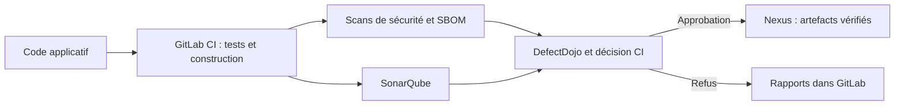

<p align="center">
  
</p>

# OSSF · Open Source Software Factory

**Une plateforme DevSecOps de laboratoire, du code aux artefacts approuvés.**

Installez GitLab CE, Runner, SonarQube, DefectDojo et Nexus sur Ubuntu, puis
intégrez l’un des **six pipelines CI génériques** à votre application.

[](LICENSE)
[](docs/INSTALLATION.md)
[](samples-gitlab-ci/README.md)

[Commencer](#démarrage-rapide) · [Choisir un pipeline](#pipelines-disponibles) ·
[Documentation](#documentation) · [Signaler un problème](https://github.com/AntoineMeheut/ossf/issues)

<details>
<summary><strong>Sommaire</strong></summary>

- [Présentation](#présentation)
- [Prérequis et compatibilité](#prérequis-et-compatibilité)
- [Démarrage rapide](#démarrage-rapide)
- [Pipelines disponibles](#pipelines-disponibles)
- [Architecture](#architecture)
- [Documentation](#documentation)
- [Structure du dépôt](#structure-du-dépôt)
- [Tests et validation](#tests-et-validation)
- [Contribuer et obtenir de l’aide](#contribuer-et-obtenir-de-laide)
- [Licence](#licence)

</details>

## Présentation

OSSF s’adresse aux équipes qui souhaitent construire un laboratoire DevSecOps,
réaliser une démonstration ou évaluer une chaîne de livraison contrôlée.
Le dépôt fournit les scripts d’installation et les modèles CI à adapter à vos
sources, vos tests et votre environnement.

| Besoin | Fonctionnalité fournie |
| --- | --- |
| Déployer les outils | Cinq installateurs Ubuntu, versions définies et contrôles de disponibilité |
| Centraliser la configuration | Un fichier privé avec génération des secrets et lecture littérale |
| Contrôler le code | Tests, couverture, Secret Detection, SAST et SonarQube |
| Examiner les dépendances | Audits adaptés au langage et inventaires CycloneDX |
| Vérifier les images | Construction depuis les artefacts testés, contrôle runtime et Container Scanning |
| Décider d’une publication | Rapports regroupés dans DefectDojo et politique de refus dans le CI |
| Conserver les livrables | Publication Nexus liée au commit et aux empreintes SHA-256, puis relecture |

L’installation des services précède la configuration des intégrations :
l’enregistrement du Runner, les projets applicatifs et les accès CI sont à
préparer selon le [guide d’intégration](docs/CI.md).

## Prérequis et compatibilité

| Usage | Prérequis |
| --- | --- |
| Installation des services | Ubuntu Server **26.04**, systemd actif, accès root et Internet |
| Architecture des installateurs | **amd64** ou **arm64** ; validation native documentée sur Ubuntu 26.04.1 ARM64 |
| Préparation des fichiers | Git, Python 3 ; Bash et OpenSSL pour générer la configuration privée |
| Analyseurs officiels GitLab | Runner Docker **Linux AMD64** ; l’émulation ARM se qualifie séparément |
| Exécution des pipelines | Runner de projet protégé, références protégées et accès dédiés aux services |

> [!IMPORTANT]
> Le profil **C** utilise Cppcheck pour le SAST et nécessite **SonarQube CFamily**
> pour l’analyse de code. L’édition Community Build installée par défaut ne couvre
> pas cette étape. Consultez les [prérequis du profil C](docs/CI.md#profil-c).

Les installateurs préparent un laboratoire HTTP. Les accès, le TLS, la supervision,
les sauvegardes et la qualification de charge sont à configurer avant une
utilisation en production.

## Démarrage rapide

### 1. Récupérer le dépôt

```sh
git clone https://github.com/AntoineMeheut/ossf.git
cd ossf
```

### 2. Choisir votre point d’entrée

#### Installer la plateforme

Sur le poste d’administration, générez la configuration une seule fois :

```sh
bash scripts/init-config.sh
chmod 600 config/ossf.env
```

Renseignez le domaine et les adresses électroniques dans `config/ossf.env`.
Copiez ensuite le dépôt complet et **le même fichier privé** sur les VM Ubuntu,
puis exécutez les commandes du [guide d’installation](docs/INSTALLATION.md).

Le [guide de configuration](docs/CONFIGURATION.md) décrit les 31 paramètres et
leurs contraintes. Le fichier privé est lu comme des données : ne le chargez
pas avec `source` et ne le commitez pas.

#### Ajouter un pipeline à votre application

Si vos services sont prêts, assemblez le profil correspondant à votre projet :

```sh
# Exemple : application Python. La destination doit être nouvelle.
python3 samples-gitlab-ci/security/prepare-example.py python /tmp/python-ci-overlay
```

Remplacez `python` par `django`, `java`, `angular`, `angular-java` ou `c` selon le
projet. L’outil ajoute le helper partagé `ci/pipeline.py` et copie uniquement
les fichiers du modèle.

1. Examinez l’overlay et fusionnez-le dans votre dépôt applicatif.
2. Adaptez les chemins, les commandes de tests et le contrat de démarrage.
3. Configurez le Runner et les [variables CI protégées](docs/CI.md#variables-ci).
4. Validez le YAML dans GitLab, puis exécutez le pipeline avec votre code.

Les instructions propres à chaque langage sont dans le [guide CI](docs/CI.md).

<a id="gitlab-ci-examples"></a>
<a id="choisir-un-modèle-ci"></a>

## Pipelines disponibles

| Profil | Projet cible | Tests et build | Livrables |
| --- | --- | --- | --- |
| [Python](samples-gitlab-ci/python/.gitlab-ci.yml) | Paquet Python PEP 517 | pytest, coverage.py, wheel | Image et wheel dans une archive |
| [Django](samples-gitlab-ci/django/.gitlab-ci.yml) | Application Django | Tests Django, couverture, Gunicorn | Image applicative |
| [Java](samples-gitlab-ci/java/.gitlab-ci.yml) | Application Java/Maven | JUnit, JaCoCo, JAR exécutable | Image et JAR |
| [Angular](samples-gitlab-ci/angular/.gitlab-ci.yml) | SPA Angular avec npm | Scripts `test:ci` et `build:ci` | Image Nginx du bundle testé |
| [Angular + Java](samples-gitlab-ci/angular-java/.gitlab-ci.yml) | Frontend Angular et backend Maven | Tests et couverture des deux composants | Deux images et un JAR |
| [C](samples-gitlab-ci/c/.gitlab-ci.yml) | Application CMake et Conan 2 | CTest, gcovr, Cppcheck | Image et installation empaquetée |

Chaque profil produit des **SBOM CycloneDX**, regroupe ses rapports dans
**DefectDojo** et applique une barrière avant publication dans **Nexus**.
Les alternatives CE à Dependency Scanning Ultimate sont pip-audit, npm audit,
OWASP Dependency-Check ou Grype selon le langage.

Un scan réussi peut contenir des alertes. La publication exige une décision
favorable de la barrière, puis la vérification des fichiers approuvés.
Consultez la [politique de livraison](docs/CI.md#rapports-et-décision-de-publication)
et le [catalogue des modèles](samples-gitlab-ci/README.md).

## Architecture

La topologie proposée répartit les services sur trois machines :

| Machine | Services | Ports applicatifs par défaut |
| --- | --- | --- |
| 1 | GitLab CE, Runner, Docker et DefectDojo | GitLab `80` · DefectDojo `8088` |
| 2 | SonarQube et PostgreSQL local | SonarQube `9000` |
| 3 | Nexus Repository | Nexus `8081` |



Le [guide d’architecture](docs/ARCHITECTURE.md) détaille les flux réseau, la
séparation des bases de données et les frontières de confiance. Le déploiement
et l’exploitation de vos applications restent propres à votre environnement.

<details>
<summary><strong>Versions de la plateforme définies dans le dépôt</strong></summary>

| Composant | Version par défaut |
| --- | --- |
| GitLab CE / Runner | `19.4.1` / `19.4.1` |
| SonarQube Community Build | `26.9.0.129388` |
| Nexus Repository Community Edition | `3.96.3-01` |
| DefectDojo | `3.3.200` |
| Docker Engine / Compose | `29.8.1` / `5.5.1` |

SonarQube utilise OpenJDK 25 et PostgreSQL 18 ; Nexus conserve son Java embarqué.
Les valeurs de référence figurent dans
[`config/ossf.env.example`](config/ossf.env.example) et les installateurs.
Tout changement de version demande un examen de compatibilité, des tests et la
procédure de migration du produit concerné.

</details>

## Documentation

| Guide | À consulter pour… |
| --- | --- |
| [Installation](docs/INSTALLATION.md) | Préparer les VM et installer les services dans le bon ordre |
| [Configuration](docs/CONFIGURATION.md) | Comprendre les paramètres et gérer les secrets |
| [Pipelines CI](docs/CI.md) | Adapter un profil, configurer le Runner et publier les artefacts |
| [Architecture](docs/ARCHITECTURE.md) | Comprendre les responsabilités et les flux |
| [Exploitation](docs/OPERATIONS.md) | Diagnostiquer, réexécuter et préparer les sauvegardes |
| [Développement](docs/DEVELOPMENT.md) | Lire les contrats des helpers et modifier le code |
| [Validation](docs/VALIDATION.md) | Identifier les contrôles exécutés et leurs limites |

## Structure du dépôt

```text
ossf/
├── config/ossf.env.example   Référence publique de configuration
├── install-*/               Cinq installateurs Ubuntu
├── scripts/                 Configuration partagée et wrapper DefectDojo
├── samples-gitlab-ci/        Six profils CI et helpers
├── tests/docker/            Tests des installateurs avec systemd
├── docs/                    Guides d’utilisation et documentation technique
├── CONTRIBUTING.md          Guide de contribution
└── LICENSE                  Licence MIT du dépôt
```

## Tests et validation

Les helpers CI disposent de **39 tests unitaires**. La compilation YAML, les
fixtures applicatives et les contrôles des images complètent ces vérifications
sur les périmètres documentés dans le [guide de validation](docs/VALIDATION.md).

Pour exécuter les tests de politique et de publication simulée :

```sh
python3 -m venv /tmp/ossf-policy-tests
/tmp/ossf-policy-tests/bin/pip install requests==2.34.2
/tmp/ossf-policy-tests/bin/python -m unittest discover \
  -s samples-gitlab-ci/security -p 'test_*.py'
```

Pour les installateurs, consultez les [tests Docker](tests/docker/README.md).
Chaque application doit qualifier son pipeline complet avec ses dépendances,
ses services, ses droits et ses contrats de démarrage.

## Contribuer et obtenir de l’aide

Les corrections, améliorations et nouveaux profils sont les bienvenus.
Commencez par le [guide de contribution](CONTRIBUTING.md).

Pour signaler un problème, ouvrez une
[issue](https://github.com/AntoineMeheut/ossf/issues) avec les versions,
l’architecture, le profil et des journaux expurgés. Conservez les secrets et le
code applicatif confidentiel hors des issues et contributions publiques.

**Mainteneur :** [Antoine Meheut](https://github.com/AntoineMeheut).

## Licence

Le code de ce dépôt est distribué sous [licence MIT](LICENSE).
Les produits et outils intégrés conservent leurs propres licences ; leurs
conditions d’utilisation s’appliquent séparément.
