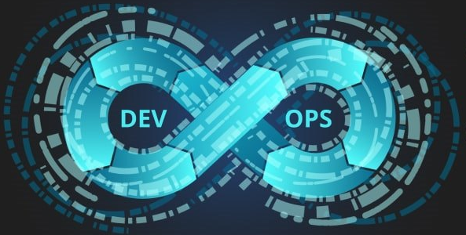
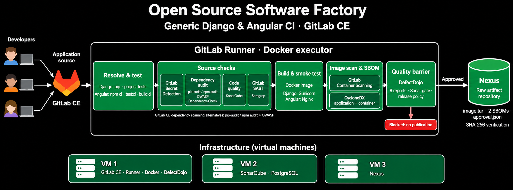

<p align="center">
  
</p>

# Open Source Software Factory

A small software factory built around GitLab CE, GitLab Runner, SonarQube
Community Build, Nexus Repository Community Edition and DefectDojo. This project
provides installation scripts sharing one private configuration file and starter
GitLab CI examples for a
lab or a small team's evaluation environment.



## Supported platform and versions

Use **Ubuntu Server 26.04.1 LTS**, with systemd, on **amd64 or arm64**. The
installers target the Ubuntu 26.04 release series. The following stable versions
were selected on **27 September 2026** and pinned so a later release does not
silently change a fresh installation.

| Component | Default version | Installation |
| --- | --- | --- |
| GitLab CE | 19.4.1 | Official Linux package |
| GitLab Runner | 19.4.1 | Official Linux package |
| SonarQube Community Build | 26.9.0.129388 | Official ZIP, native systemd service |
| SonarQube Java / database | OpenJDK 25 / PostgreSQL 18 | Ubuntu packages, current security updates |
| Nexus Repository | 3.96.3-01 | Official archive, bundled Java 21 |
| DefectDojo | 3.3.200 | Upstream Docker Compose release |
| DefectDojo database / cache | PostgreSQL 18.6 / Valkey 9.1.2 | Images pinned by upstream Compose |
| Docker Engine / Compose | 29.8.1 / 5.5.1 | Official stable APT repository |

The latest compatible Java version is used for SonarQube; Nexus keeps its
vendor-supplied runtime. Other Ubuntu dependencies receive the versions available
from the configured Ubuntu repositories.

Release and compatibility references: [Ubuntu 26.04](https://documentation.ubuntu.com/release-notes/26.04/),
[GitLab packages](https://docs.gitlab.com/install/package/),
[SonarQube downloads](https://www.sonarsource.com/products/sonarqube/downloads/),
[SonarQube Java requirements](https://docs.sonarsource.com/sonarqube-community-build/server-installation/server-host-requirements),
[Nexus downloads](https://help.sonatype.com/en/download.html),
[DefectDojo 3.3.200](https://github.com/DefectDojo/django-DefectDojo/releases/tag/3.3.200),
[Docker on Ubuntu](https://docs.docker.com/engine/install/ubuntu/).

## Prepare the machines

The suggested lab layout uses three machines:

| Machine | Services | Application ports |
| --- | --- | --- |
| 1 | GitLab CE, Runner, Docker, DefectDojo | GitLab HTTP 80, SSH 22; DefectDojo HTTP 8088, TLS 8443 |
| 2 | SonarQube, local PostgreSQL | SonarQube HTTP 9000 |
| 3 | Nexus | Nexus HTTP 8081 |

Size each machine for its workloads and the publishers' requirements; GitLab,
DefectDojo and build containers share machine 1's resources. Docker is needed on
machine 1, but not for the native SonarQube or Nexus installations. A separate
DefectDojo machine is also possible.

Start with fresh Ubuntu Server installations, configure DNS for GitLab, and copy
or clone this repository on each machine:

```sh
git clone https://github.com/AntoineMeheut/ossf.git
cd ossf
```

These scripts configure a lab over HTTP. Configure TLS, access controls, mail,
backups and external exposure for your deployment before using it in production.
GitLab Runner registration and the integrations between applications are separate
steps; installing the services does not create a complete analysis pipeline.

## One private configuration file

All five installers read **`config/ossf.env`** automatically. The tracked
[config/ossf.env.example](config/ossf.env.example) lists every supported key and
contains no passwords. Create the private file **once**, on your administration
workstation, with Bash and OpenSSL:

```sh
bash scripts/init-config.sh
# Edit the hostname and email addresses before installing:
${EDITOR:-vi} config/ossf.env
```

The initializer generates independent random administrator passwords, database
passwords and DefectDojo encryption keys, sets mode **600**, and never overwrites
an existing file. The private file is excluded from Git. Keep a protected backup
and copy **the same file** to `config/ossf.env` in the repository on each VM;
keep its permissions at 600. Keep the complete repository: the installers also
need `scripts/config.sh` and the configuration template.

The template and generated private file include English maintenance comments for
every variable: its VM, purpose, constraints and relationship to other services.
VM numbers refer to the layout above. In particular, SonarQube's local PostgreSQL
on VM 2 is separate from DefectDojo's PostgreSQL container on VM 1.

| VM | Purpose | Keys in `config/ossf.env` |
| --- | --- | --- |
| 1 | GitLab hostname and administrator | `GITLAB_DOMAIN`, `GITLAB_ADMIN_USER`, `GITLAB_ROOT_EMAIL`, `GITLAB_ROOT_PASSWORD` |
| 1 | GitLab and Runner packages | `GITLAB_VERSION`, `RUNNER_VERSION` |
| 1 | Docker and Compose | `DOCKER_VERSION`, `COMPOSE_VERSION` |
| 1 | DefectDojo installation and ports | `DEFECTDOJO_VERSION`, `INSTALL_DIR`, `DD_PORT`, `DD_TLS_PORT` |
| 1 | DefectDojo administrator | `DD_ADMIN_USER`, `DD_ADMIN_MAIL`, `DD_ADMIN_PASSWORD` |
| 1 | DefectDojo database | `DD_DATABASE_USER`, `DD_DATABASE_NAME`, `DD_DATABASE_PASSWORD` |
| 1 | DefectDojo persistent encryption/signing keys | `DD_SECRET_KEY`, `DD_CREDENTIAL_AES_256_KEY` |
| 2 | SonarQube archive | `SONARQUBE_ARCHIVE`, `SONARQUBE_SHA256` |
| 2 | SonarQube administrator | `SONARQUBE_ADMIN_USER`, `SONARQUBE_ADMIN_PASSWORD` |
| 2 | SonarQube PostgreSQL database | `SONARQUBE_DB_USER`, `SONARQUBE_DB_NAME`, `SONARQUBE_DB_PASSWORD` |
| 3 | Nexus version and administrator | `NEXUS_VERSION`, `NEXUS_ADMIN_USER`, `NEXUS_ADMIN_PASSWORD` |
| 1, 2, 3 | Readiness timeout in seconds | `WAIT_TIMEOUT` |

The initial GitLab account is `root`; the SonarQube and Nexus accounts are `admin`.
These three names must keep their template values. DefectDojo's admin name and the
SonarQube database user/name are configurable. Upstream DefectDojo Compose fixes
its database user and name to `defectdojo`.

The format is **literal `KEY=value`**, one line per setting: no `export`, quotes,
variable interpolation or inline comments. A line beginning with `#` is a comment;
`#` in a value is part of that value. Spaces, `$`, quotes and backslashes in a
password remain literal. Do **not** `source` the file. Passwords must contain at
least 16 printable ASCII characters; the AES key must contain 32 hexadecimal
characters. Applications may also enforce their own password-strength rules;
GitLab rejects predictable passwords even when they include punctuation. The
initializer supplies random values for all secrets.

For a file outside the checkout, supply its path explicitly:

```sh
sudo env OSSF_CONFIG=/etc/ossf/ossf.env \
  bash install-gitlab-ce/gitlab-ubuntu-server.sh
```

This works with every installer and the DefectDojo Compose wrapper. Settings are
read from the file; individual environment variables no longer override them.
The optional GitLab `-d` and SonarQube `--archive` arguments override only the
corresponding value for that invocation. No password needs to appear in a command.

## Machine 1: Docker, GitLab and DefectDojo

```sh
sudo bash install-docker/docker-ubuntu-server.sh
sudo bash install-gitlab-ce/gitlab-ubuntu-server.sh
sudo bash install-defectdojo/defectdojo-ubuntu-server.sh
```

The configuration defaults to port 8088 to avoid GitLab's internal port 8080.
Set `DD_PORT=8080` in the configuration if DefectDojo runs on a separate machine.

Set `GITLAB_DOMAIN` to your hostname, without a scheme, path or port.
The script sets GitLab's external URL before package installation. Register the
Runner afterwards with a runner authentication token from your GitLab instance.

Docker's installer configures its official signed APT repository and installs
Engine, CLI, Compose, Buildx and containerd. Existing conflicting distribution
packages are reported instead of removed automatically.

DefectDojo uses its upstream Compose configuration in `/opt/defectdojo`, with
matching release images, PostgreSQL and Valkey. The installer waits for successful
initialization, then starts the application and checks the login page. Credentials
and encryption keys come from the central configuration. The installer writes a
private runtime copy to `/opt/defectdojo/.ossf.env`; do not edit or source that
copy. Back up the central configuration together with the database and volumes.
Set `INSTALL_DIR`, `DD_PORT` and `DD_TLS_PORT` in the configuration before the
first installation.

Use the wrapper to operate Compose with exactly the same literal credentials:

```sh
sudo bash scripts/defectdojo-compose.sh ps
sudo bash scripts/defectdojo-compose.sh logs --tail 50 uwsgi
```

## Machine 2: SonarQube

```sh
sudo bash install-sonarqube/sonarqube-ubuntu-server.sh
```

SonarQube remains a native Java/systemd installation. The script downloads the
official ZIP, verifies its pinned SHA-256, installs JDK 25 and PostgreSQL 18,
creates a dedicated service account and database, applies Elasticsearch's kernel
and service limits, and waits for application status `UP`.

A local copy of the same official ZIP is also supported:

```sh
sudo bash install-sonarqube/sonarqube-ubuntu-server.sh \
  --archive /path/to/sonarqube-26.9.0.129388.zip
```

`SONARQUBE_ARCHIVE` in the configuration is equivalent to `--archive`. The default
checksum is pinned from the official HTTPS download; `SONARQUBE_SHA256` can override it with a trusted
expected checksum. A local archive still needs online access for Ubuntu packages.
A normal rerun with an empty `SONARQUBE_ARCHIVE` neither downloads nor requires
the archive. After startup, the installer replaces the initial admin password
with `SONARQUBE_ADMIN_PASSWORD` and verifies authentication.

## Machine 3: Nexus

```sh
sudo bash install-nexus/nexus-ubuntu-server.sh
```

The installer selects the architecture-specific archive, verifies the upstream
SHA-256 and uses Nexus's bundled Java runtime. The application runs under the
`nexus` account with data in `/opt/sonatype-work`. Once Nexus is ready, the
installer replaces its generated initial password with `NEXUS_ADMIN_PASSWORD`
and verifies administrator authentication.

Complete Nexus Community Edition's first-use onboarding, including reviewing and
accepting its license, before publishing artifacts. Readiness and authentication
checks do not accept the license; writes remain blocked until that step is done.

## Credentials and repeated runs

`config/ossf.env` is the source of truth for deployment credentials. GitLab receives
its configured root password/email on the first package installation; SonarQube
and Nexus configure their administrator through their local APIs. DefectDojo's
initializer receives the configured admin account. Generated passwords are never
printed by the project scripts.

Applications still need runtime copies: SonarQube's JDBC properties/database
password file, GitLab's application secrets and DefectDojo's `.ossf.env`/container
environment. These are generated application state, not separate settings to
maintain manually. GitLab's `initial_root_password` file can expire; the configured
password remains available in the private configuration.

All installers require root and running systemd, stop on command errors and check
readiness. `WAIT_TIMEOUT` in the file sets the readiness timeout (default 900
seconds). `--help` works even before the configuration exists.

A second run of the same managed version preserves credentials and data. Saved
configuration fingerprints detect changed credentials and fail before package or
database changes. Changing a password in the file is **not** a password-rotation
procedure: follow the application's rotation procedure and keep the configuration
and managed state consistent afterwards.

For an installation created before the shared configuration was introduced,
first import its **actual** administrator passwords, database credentials,
DefectDojo keys, ports and account names. A newly generated file cannot recover
existing secrets. If SonarQube still uses `admin` / `admin`, keep a new strong
`SONARQUBE_ADMIN_PASSWORD`: the installer replaces that initial default.
Mismatching database/DefectDojo runtime settings are rejected;
GitLab's initial password option does not reset an existing account. Application
version upgrades and Ubuntu migrations still follow the publishers' procedures.

If GitLab reports `Configured GitLab password does not match the installed account`
after `gitlab Reconfigured!`, the final password check failed. Check the configuration
path printed by the installer (`config/ossf.env` by default, or `OSSF_CONFIG`). To set
the existing `root` account to that file's `GITLAB_ROOT_PASSWORD`, run the
[GitLab password reset task](https://docs.gitlab.com/security/reset_user_password/#use-a-rake-task)
on the GitLab VM:

```sh
sudo gitlab-rake "gitlab:password:reset[root]"
```

Enter the exact configured value at both password prompts, then rerun the installer
with the same configuration file and domain. The task changes the existing account's
password. Initial-account settings and another `gitlab-ctl reconfigure` cannot do
this. Configuration values are literal: do not add enclosing quotes or `source`
the file. The installer preserves its password check and only saves the configuration
fingerprint after it succeeds.

Version keys select releases for a fresh installation. Changing a default requires
upstream compatibility review and rerunning the tests; these keys are not an
application upgrade command.

## GitLab CI examples

Three reusable examples are provided: [Django](samples-gitlab-ci/django/.gitlab-ci.yml),
[Angular](samples-gitlab-ci/angular/.gitlab-ci.yml) and
[Angular + Java](samples-gitlab-ci/angular-java/.gitlab-ci.yml). They contain CI configuration
and helper scripts, with no application source, project-specific tests or private
execution reports. Integrate an example into your own application's GitLab repository.

### What each pipeline does

| Step | Django | Angular |
| --- | --- | --- |
| Dependencies | Resolve the application's requirements.txt into wheels | Install the application's package-lock.json with npm ci |
| Application checks | Run the project's Django tests and collect Python coverage | Run the project's test:ci and build:ci npm scripts |
| Secrets | Official GitLab Secret Detection, including repository history | Same |
| Dependency security | pip-audit and OWASP Dependency-Check | npm audit and OWASP Dependency-Check |
| Code quality | SonarQube with Python coverage | SonarQube with the project's LCOV report |
| SAST | Official GitLab Semgrep SAST | Same |
| Build | Application Docker image served by Gunicorn | Nginx Docker image containing the tested production SPA bundle |
| Image security | Official GitLab Container Scanning on the built image archive | Same |
| Inventory | Application and container CycloneDX SBOMs | Same |
| Release barrier | Import eight reports into DefectDojo and evaluate the policy | Same |
| Publication | Upload the approved image, both SBOMs and approval evidence to Nexus | Same |

The Angular + Java profile extends the Angular checks with Maven/JUnit tests,
JaCoCo coverage and a Maven CycloneDX SBOM. OWASP checks both dependency inventories.
SonarQube analyzes TypeScript and Java together. Two separate runtime images are
built and smoke-tested, then scanned by two official GitLab Container Scanning
jobs. The barrier requires **twelve reports** and approves both images, the Java
JAR and four SBOMs together before Nexus publication.

GitLab CE does not provide Ultimate's native Dependency Scanning. The ecosystem
audit and OWASP jobs above are the explicit CE alternatives. Reports remain
available as CI artifacts; Ultimate vulnerability dashboards are not assumed.

### Prepare an overlay and integrate it into your application

Run from your checkout of this repository, choosing **one** profile:

```sh
python3 samples-gitlab-ci/security/prepare-example.py django /tmp/django-ci-overlay
# Or, for an Angular application:
python3 samples-gitlab-ci/security/prepare-example.py angular /tmp/angular-ci-overlay
# Or, for an Angular frontend and Java/Maven backend:
python3 samples-gitlab-ci/security/prepare-example.py angular-java /tmp/angular-java-ci-overlay
```

The destination must be new. The tool copies only the selected CI template and
installs the shared helper as `ci/pipeline.py`; it never reads or copies your
application source. Review the overlay, then integrate these files at the root of
your application's repository, next to manage.py or package.json:

```text
.gitlab-ci.yml
Dockerfile
.dockerignore
.gitignore
sonar-project.properties
ci/                     # includes the required shared pipeline.py
```

Merge existing CI, Docker, ignore and Sonar files instead of overwriting them.
Keep your own dependency manifests, lock files, source and tests. The Django
`requirements.txt.example` is an optional starting point for a new application;
it must not replace an existing project's requirements.txt. Commit the integrated
files in the **application's GitLab repository** after completing the setup below.

For Angular + Java, place the overlay at the monorepo root, alongside frontend/
and backend/. Its two Dockerfiles are under ci/; there is no root Dockerfile.

### Adapt the Django example

1. Provide manage.py at the repository root and a requirements.txt containing
   your application's complete, pinned dependency set, including Gunicorn. The
   tool dependencies are separate, in ci/requirements.txt.
2. Set `DJANGO_WSGI_MODULE` in .gitlab-ci.yml or a GitLab variable, for example
   `myproject.wsgi:application`. The Docker build records this non-secret module
   name in the image. All application packages, templates and static files are
   copied through the generic Dockerfile; review .dockerignore for your project.
3. Keep `python manage.py test` as the test contract, or change django_tests to
   your existing runner. Configure test settings, required environment variables
   and any database/cache service your tests need. `DJANGO_SETTINGS_MODULE` can
   select a dedicated CI settings module. The sample generates DJANGO_SECRET_KEY
   for tests; adapt your settings if your application uses a different variable.
4. Provide a lightweight HTTP endpoint that returns 200 without a database query,
   and set `DJANGO_SMOKE_PATH` to its path (default `/health/`). For example, add
   `path("health/", lambda request: JsonResponse({"status": "ok"}))` to your URL
   configuration, importing path and JsonResponse. The runtime smoke test uses
   127.0.0.1:8000: allow that host in your CI settings, read DJANGO_SECRET_KEY from
   the environment, and provide any other startup configuration in build_container.
5. Review sonar-project.properties. The default discovers Python source and common
   test filenames under the repository root, and reads coverage.xml. Adjust the
   source/test paths for a src layout, multiple packages or different test naming.
6. Choose a Python release supported by your application. The example pins Python
   3.14.7; update the job images, Dockerfile and Sonar Python version together when
   changing it. pip-audit discovers the application virtualenv's site-packages
   dynamically. Wheel resolution uses binary wheels only: dependencies needing
   compilation or system libraries require adapting resolution and the Dockerfile.

Supply production secrets, database configuration and static-file serving at
runtime. The sample image runs Gunicorn as UID 10001; it does not run migrations,
collectstatic or deploy the application automatically.

### Adapt the Angular example

1. Keep your own package.json, package-lock.json, angular.json, source and tests.
   The example expects an npm-managed workspace at the repository root. For a
   monorepo, adapt working directories, artifact paths and Sonar source paths.
2. Add two scripts to your package.json, using the actual workspace project name
   and the test builder already installed in your project. For a current Angular
   Vitest builder, an example is:

   ```json
   {
     "scripts": {
       "test:ci": "ng test my-app --watch=false --coverage --coverage-reporters=lcov",
       "build:ci": "ng build my-app --configuration production"
     }
   }
   ```

   [Angular's test command reference](https://angular.dev/cli/test) documents the
   current options. Older Karma builders may use `--code-coverage` instead of
   `--coverage`. Keep the command compatible with your installed Angular version.
   A missing test:ci script or a failing test fails the pipeline; tests are not
   silently replaced by a smoke test.
3. The job installs Chromium and sets `CHROME_BIN=/usr/bin/chromium`. If your Karma
   configuration runs a real browser as root in the CI container, define a custom
   launcher such as `ChromeHeadlessCI` with base `ChromeHeadless` and flags
   `["--no-sandbox"]`, and select it with `--browsers=ChromeHeadlessCI`. Vitest/jsdom
   tests can use their normal non-browser mode. Use your project's own dependencies
   and test configuration; no application-specific browser scenario is injected.
4. Set `ANGULAR_DIST_DIR` to the directory containing the built index.html, such as
   `dist/my-app/browser` or `dist/my-app`. The default is `dist/app/browser`.
   After successful tests/build, the pipeline copies this directory to `.ci-dist/`.
   The Dockerfile copies that exact tested bundle into Nginx; it does not rebuild it.
5. Set `ANGULAR_SMOKE_PATH` to an appropriate public route (default `/`). The image
   smoke check compares its HTTP response with the tested index.html. Nginx runs as
   `nginx` on port 8080 and provides SPA route fallback. Server-side rendered Angular
   applications need a suitable Node runtime Dockerfile and corresponding smoke test.
6. Configure your test runner to write LCOV coverage and set
   `sonar.javascript.lcov.reportPaths` to its actual path (default
   `coverage/lcov.info`). The job retains coverage/ as an artifact. Adjust
   `sonar.sources` and tsconfig paths for your workspace layout.
7. Select a Node release supported by your Angular version in the default image.
   The example pins Node 22.23.2; consult
   [Angular's compatibility table](https://angular.dev/reference/versions) before
   changing the image. Application dependencies are never upgraded by this CI.

### Adapt the Angular + Java example

This profile targets an npm-managed Angular SPA and a Java backend packaged as an
**executable Maven JAR**, including Spring Boot. It contains no application source
or business-specific configuration. A typical consuming repository is:

```text
.gitlab-ci.yml
sonar-project.properties
ci/                          # generic helpers and two Dockerfiles
frontend/
  package.json               # your test:ci and build:ci scripts
  package-lock.json
  angular.json
  src/
backend/
  pom.xml                    # executable JAR, tests and JaCoCo report
  src/main/
  src/test/
```

1. Merge the overlay into your repository. Keep the application's existing npm
   lock file and Maven POM. The CI does not upgrade application dependencies.
   Define the frontend scripts as described for Angular above. For an existing
   @angular/build:karma builder, the optional ci/karma.conf.cjs resolves Jasmine, Chrome and
   coverage plugins from your frontend dependencies. A compatible script is
   `ng test --watch=false --code-coverage --browsers=ChromeHeadlessCI --karma-config=../ci/karma.conf.cjs`.
   It runs your existing test suites; change the relative path if moving frontend/.
2. Configure these non-secret variables in the YAML or protected GitLab variables:

   | Variable | Default | Adaptation |
   | --- | --- | --- |
   | `FRONTEND_DIR` | `frontend` | npm workspace directory, relative to repository root |
   | `BACKEND_DIR` | `backend` | Directory containing the Maven POM |
   | `ANGULAR_DIST_DIR` | `frontend/dist/app/browser` | Built directory containing index.html, relative to repository root |
   | `FRONTEND_LCOV` | `frontend/coverage/lcov.info` | Frontend coverage report, relative to repository root |
   | `BACKEND_JAR_GLOB` | `backend/target/*.jar` | Must select exactly one executable JAR |
   | `JAVA_SOURCE` | `17` | Java source release reported to SonarQube; keep consistent with both Java images |
   | `ANGULAR_SMOKE_PATH` | `/` | Frontend route returning the SPA index |
   | `BACKEND_PORT` | `8080` | Actual backend HTTP port inside its container |
   | `BACKEND_SMOKE_PATH` | `/actuator/health` | Existing endpoint returning HTTP 200 |

   Set a real endpoint: the example does not add Actuator to your dependencies.
   A missing/failing endpoint fails the build. The frontend and backend smoke
   checks verify each runtime image; they do not replace an application-specific
   end-to-end browser test.
3. The backend job runs `mvn verify dependency:copy-dependencies -DincludeScope=test`.
   Keep real tests enabled and configure JaCoCo in your POM to generate
   `target/site/jacoco/jacoco.xml`. The job exports Surefire JUnit reports and
   resolves test dependencies too, so OWASP and CycloneDX cover the build/test
   dependency set. Sonar receives classes, test classes, dependencies, JaCoCo and
   frontend LCOV. Adjust the sonar-scanner arguments and artifact paths for a
   different source tree, coverage location or multi-module Maven reactor.
4. Maven uses JDK 17 and the backend image uses a Java 17 JRE. If your application
   needs a different release, update JAVA_SOURCE, the backend_tests image and
   ci/backend.Dockerfile together. Configure your normal executable/fat JAR packaging;
   ci/normalize-jar.py refuses ambiguous selections and JARs without Main-Class.
   For a multi-module build, select the deployable module's JAR explicitly and
   scan all resolved module dependencies. Gradle and WAR/application-server
   deployments require adapting the build, dependency/SBOM jobs and Dockerfile.
5. The frontend image serves the tested bundle with Nginx on 8080. The backend
   image contains the exact tested JAR and runs as UID/GID 10001. Neither image
   includes CI credentials or runtime env files. Configure the frontend's API
   base URL and production routing using your application's normal mechanism;
   the example Nginx configuration provides SPA fallback only.
6. Supply runtime configuration for the backend smoke test using a protected
   **File** variable `BACKEND_SMOKE_ENV_FILE` containing Docker env-file entries.
   For temporary dependencies such as PostgreSQL, optionally set
   `SMOKE_SETUP_SCRIPT=./ci/smoke-setup.sh` and
   `SMOKE_CLEANUP_SCRIPT=./ci/smoke-cleanup.sh` to your own committed scripts.
   These hooks are sourced as trusted project code inside the isolated Docker
   job. The setup hook can create a temporary service/network, set
   `SMOKE_NETWORK`, and generate BACKEND_SMOKE_ENV_FILE at runtime. The cleanup
   hook must tolerate partial setup, remove only resources it created and delete
   temporary credentials. Use synthetic test data and never echo secrets.
   Unit/integration tests needing services must configure them separately in
   backend_tests; the image smoke hooks run later, in build_container.

The two Dependency-Check jobs generate separate JSON/XML/HTML reports under
reports/frontend/ and reports/backend/. Their inventories must cover the npm and
Maven PURLs from the corresponding application SBOMs. Missing scans or incomplete
dependency resolution block publication. The optional Karma adapter is unrelated
to the Java build and can be replaced by your existing frontend test configuration.
The backend uses the official
[OWASP Maven plugin](https://dependency-check.github.io/DependencyCheck/dependency-check-maven/check-mojo.html)
with test-scope scanning enabled. It obtains exact group/artifact/version identities
from Maven's resolved graph, avoiding incomplete identification from JAR filenames
or external SHA-1 search. As in the plugin defaults, the separate Maven Central
enrichment analyzer is unused because this metadata is already available from
the build. The frontend continues to use the official OWASP CLI with Node Audit.

### Configure the Runner and external services

Use a dedicated **project Runner**, tagged `ossf-security`, locked to the project,
with untagged jobs disabled and access restricted to protected refs. The workflow
runs only on the protected default branch. Use a native AMD64 Docker Runner for
GitLab's official analyzers; an ARM64 Runner requires binfmt/QEMU emulation, which
is outside their supported native architecture. The installation scripts do not
register project Runners or create application projects automatically.

The relevant Runner settings are:

```toml
concurrent = 1
[[runners]]
  executor = "docker"
  limit = 1
  [runners.docker]
    privileged = true
    volumes = ["/certs/client", "/cache"]
```

Register the Runner with its GitLab-issued authentication token through the normal
Runner registration flow. Docker-in-Docker uses TLS on port 2376. Run trusted code
on this privileged Runner and do not mount the host Docker socket. Provide enough
RAM/disk for the services, scanner caches and image archives. In Settings > CI/CD >
General pipelines, increase the project's maximum artifact size to fit the job's
**combined artifact archive**. Angular + Java transfers both raw image archives
and the JAR in one build job. GitLab's default 100 MB limit can cause HTTP 413
even when each individual compressed image would fit; see
[GitLab's artifact size settings](https://docs.gitlab.com/ci/jobs/job_artifacts/#set-the-maximum-artifacts-size).

Create a private SonarQube project, a DefectDojo product and a Nexus raw hosted
repository for the application. Give the Sonar CI identity Browse and Execute
Analysis on its project; also give the human reviewer Browse. Inspect inherited
global and project-group grants. Give the non-administrator Dojo identity access
to its product, and the Nexus publisher browse/read/add/edit only on its repository.
Use Nexus `ALLOW_ONCE` for immutable publications. Complete Nexus onboarding and
review/accept its license as administrator before attempting uploads.

Create these **protected** GitLab project variables under Settings > CI/CD > Variables:

| Variable | Example/purpose | Secret to mask |
| --- | --- | --- |
| `SONAR_HOST_URL` | `https://sonar.example.com` | No |
| `SONAR_PROJECT_KEY` | Application's private Sonar project key | No |
| `SONAR_TOKEN` | Dedicated CI identity's token, able to analyze and export results | Yes |
| `DEFECTDOJO_URL` | `https://dojo.example.com` | No |
| `DEFECTDOJO_PRODUCT_ID` | Numeric ID of the application's product | No |
| `DEFECTDOJO_TOKEN` | Non-administrator product identity's API token | Yes |
| `NEXUS_URL` | `https://nexus.example.com` | No |
| `NEXUS_REPOSITORY` | Raw hosted repository name, e.g. `application-releases` | No |
| `NEXUS_USER` | Dedicated publisher login | No |
| `NEXUS_PASSWORD` | Publisher password | Yes |
| `DD_MIN_SEVERITY` | `High` by default | No |

URLs must be HTTP(S) origins without API paths, credentials, queries or fragments.
Use HTTPS for shared environments. Keep administrator credentials and Runner tokens
out of application repositories and CI variables. Configure separate Sonar project
keys for separate apps/branches; Community Build analyzes one branch per project.
The analysis job serializes access and verifies the analyzed commit and analysis ID.

### Understand the release decision and retrieve artifacts

Validate the integrated YAML in GitLab's Pipeline Editor/CI Lint, push to the
protected default branch and open Build > Pipelines. Inspect each job's log and
artifacts. A successful scanner job means it executed successfully, not that the
application is free of findings. The barrier requires all eight reports for
Django/Angular, or twelve for Angular + Java, and
completed synchronous DefectDojo imports in a distinct engagement per CI run.

Publication is refused for any active finding at or above `DD_MIN_SEVERITY`, any
pip-audit/npm audit finding, any unknown severity, an incomplete/missing report,
an API error or a Sonar quality gate other than `OK`. Unverified and duplicate
findings count conservatively. Dependency-Check JSON/XML inventories must agree;
for Angular, OWASP's npm inventory must also cover the application SBOM identities.
Angular + Java checks this coverage independently for npm and Maven.
OWASP uses the official NVD data feed with a cache; OSS Index enrichment is disabled
because it requires separate credentials. Angular's Node Audit analyzer remains
active and has access to the installed modules next to the lock file.

A refused release retains `reports/gate-summary.json` in the barrier job and skips
publish_nexus. Review the engagement in DefectDojo and address or triage the results;
do not treat missing/failed scans as clean reports. On success, approval.json binds
the commit/pipeline and artifact hashes. The publisher verifies the approved bytes,
uploads them and reads them back to check the stored SHA-256.

Nexus receives `image.tar`, `application-sbom.cdx.json`, `gl-sbom-report.cdx.json`
and `approval.json` under `<project-id>/<commit>/<pipeline-id>/`. This is a raw image
archive repository, rather than a Docker registry. Require approval.json, uploaded
last, when consuming a release. Retry partial publications with a new pipeline ID
because existing paths are immutable. Download image.tar and run `docker load -i
image.tar` to load the approved image. Deploy it separately with runtime configuration.

For Angular + Java, the same path contains `frontend-image.tar`,
`backend-image.tar`, `application.jar`, `frontend-sbom.cdx.json`,
`backend-sbom.cdx.json`, `frontend-container-sbom.cdx.json`,
`backend-container-sbom.cdx.json` and `approval.json`. Load each image archive with
`docker load -i <archive>`. Both images and all five accompanying artifacts must
match the hashes in the approval. A refusal for either component blocks the
complete release. A Nexus connectivity probe alone does not constitute an
approved application publication.

The outer Docker archive is not gzipped: GitLab's analyzer repeatedly reads archive
metadata, and additional gzip decompression can make that path very slow. The same
image is scanned and published. No build occurs after approval.

### Check the generic helpers locally

```sh
python3 -m venv /tmp/ci-policy-tests
/tmp/ci-policy-tests/bin/pip install requests==2.34.2
/tmp/ci-policy-tests/bin/python -m unittest discover \
  -s samples-gitlab-ci/security -p 'test_*.py'
```

These tests validate the shared policy and publisher contracts. Each consuming
application must validate its own test command, dependencies, Docker image,
service connectivity and complete pipeline before enabling releases.

The shared policy has 28 tests covering the existing profiles, complete two-image
approvals, missing backend scans, incomplete Maven inventories, unknown container
severities and changed JARs. Validate the integrated template with your installed
GitLab compiler and run the complete pipeline against your application before
enabling releases. Test executions and application-specific reports belong in the
consuming private repository, outside these generic examples.

## Validation

[Docker test instructions](tests/docker/README.md) describe how to run the actual
installers in disposable Ubuntu 26.04/systemd containers, including repeat runs
and failure handling. [Recorded results and limits](tests/docker/RESULTS.md)
distinguish executed checks from untested deployment scenarios.

## Contributing and license

Open an [issue](https://github.com/AntoineMeheut/ossf/issues) or a pull request with
the change and its validation. Distributed under the [MIT License](LICENSE).
Contact: [github.contacts@protonmail.com](mailto:github.contacts@protonmail.com).
