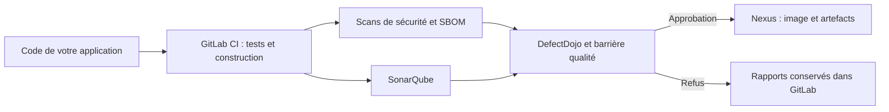

<p align="center">
  
</p>

# OSSF — Open Source Software Factory

Une fabrique DevSecOps pour installer **GitLab CE, GitLab Runner, SonarQube,
DefectDojo et Nexus**, puis intégrer des contrôles de qualité et de sécurité dans
les pipelines de vos applications.

Le dépôt fournit des installateurs Ubuntu et **six modèles GitLab CI génériques**.
Il vise les laboratoires, les démonstrations et l’évaluation technique en équipe.
Les applications et leurs résultats restent dans leurs propres dépôts.

[Installation](docs/INSTALLATION.md) · [Pipelines CI](docs/CI.md) ·
[Configuration](docs/CONFIGURATION.md) · [Documentation du code](docs/DEVELOPMENT.md)

## Fonctionnalités

- **Installation versionnée** : versions définies dans le code, vérification
  des archives, services systemd et contrôles de disponibilité.
- **Configuration centralisée** : secrets générés une seule fois dans un fichier
  privé, lu comme des données et partagé entre les machines.
- **Contrôles CI** : tests, couverture, détection de secrets, SAST, analyse des
  dépendances, SonarQube, construction et analyse des images.
- **Traçabilité** : SBOM CycloneDX, rapports conservés dans GitLab et regroupés
  dans un engagement DefectDojo par exécution.
- **Publication contrôlée** : approbation liée au commit et aux empreintes SHA-256,
  puis écriture et relecture des artefacts dans Nexus.

## Architecture

La topologie proposée utilise trois machines :

| Machine | Services | Accès applicatifs par défaut |
| --- | --- | --- |
| 1 | GitLab CE, Runner, Docker, DefectDojo | GitLab : `80` ; DefectDojo : `8088` |
| 2 | SonarQube et PostgreSQL local | SonarQube : `9000` |
| 3 | Nexus Repository | Nexus : `8081` |



L’installation des services et la configuration des intégrations CI sont deux
opérations distinctes. Les installateurs ne créent pas de projets applicatifs,
n’enregistrent pas de Runner et ne déploient pas les applications.

Consultez l’[architecture détaillée](docs/ARCHITECTURE.md) pour les flux, les ports
et la séparation des bases de données.

<a id="gitlab-ci-examples"></a>

## Choisir un modèle CI

| Profil | Projet cible | Tests et construction | Livrable applicatif |
| --- | --- | --- | --- |
| [Python](samples-gitlab-ci/python/.gitlab-ci.yml) | Paquet Python, sans framework imposé | pytest, coverage.py, PEP 517 | Wheel conservé dans une archive |
| [Django](samples-gitlab-ci/django/.gitlab-ci.yml) | Application Django | Tests Django, couverture, Gunicorn | Image applicative |
| [Java](samples-gitlab-ci/java/.gitlab-ci.yml) | Application Java/Maven | JUnit, JaCoCo, JAR exécutable | JAR et image |
| [Angular](samples-gitlab-ci/angular/.gitlab-ci.yml) | SPA Angular avec npm | Scripts `test:ci` et `build:ci` | Image Nginx du bundle testé |
| [Angular + Java](samples-gitlab-ci/angular-java/.gitlab-ci.yml) | Frontend Angular et backend Java/Maven | Tests et couverture des deux composants | Deux images et un JAR |
| [C](samples-gitlab-ci/c/.gitlab-ci.yml) | Application C avec CMake et Conan 2 | CTest, gcovr, Cppcheck | Arborescence installée et image |

**Compatibilité des éditions.** Les modèles utilisent des alternatives à
Dependency Scanning Ultimate : pip-audit, npm audit, OWASP Dependency-Check ou
Grype selon le profil. Pour C, le SAST utilise Cppcheck et l’étape SonarQube exige
un analyseur **CFamily** ; SonarQube Community Build ne couvre pas cette étape.
Le pipeline vérifie ce prérequis avant de poursuivre.

Le [guide CI](docs/CI.md) détaille les six profils, les variables à renseigner,
les règles de refus et les adaptations nécessaires à votre projet.

## Démarrage

### Installer la plateforme

Depuis le poste d’administration :

```sh
git clone https://github.com/AntoineMeheut/ossf.git
cd ossf
bash scripts/init-config.sh
```

Renseignez le domaine et les adresses électroniques dans `config/ossf.env`, puis
copiez le dépôt et **le même fichier privé**, avec les permissions `600`, sur les
machines Ubuntu. Suivez ensuite l’[ordre d’installation](docs/INSTALLATION.md).

Les scripts ciblent **Ubuntu Server 26.04**, avec systemd, sur **amd64 ou arm64**.
La validation native documentée utilise Ubuntu 26.04.1 ARM64. Les analyseurs
officiels GitLab nécessitent un Runner Linux AMD64 ; l’émulation ARM est un cas
distinct à qualifier.

### Intégrer un pipeline à votre application

Depuis le dépôt OSSF, préparez par exemple le profil Python :

```sh
python3 samples-gitlab-ci/security/prepare-example.py python /tmp/python-ci-overlay
```

Les profils disponibles sont `python`, `django`, `java`, `angular`, `angular-java`
et `c`. La destination doit être nouvelle. L’outil assemble le modèle et son
helper partagé `ci/pipeline.py` ; il ne lit pas le code de votre application.

Examinez les fichiers produits, fusionnez-les dans votre dépôt applicatif, puis
configurez le Runner et les accès aux services conformément au [guide CI](docs/CI.md).
Conservez vos sources, vos tests et vos manifestes de dépendances.

## Versions par défaut

| Composant | Version définie dans le dépôt |
| --- | --- |
| GitLab CE / Runner | `19.4.1` / `19.4.1` |
| SonarQube Community Build | `26.9.0.129388` |
| Nexus Repository Community Edition | `3.96.3-01` |
| DefectDojo | `3.3.200` |
| Docker Engine / Compose | `29.8.1` / `5.5.1` |

SonarQube utilise OpenJDK 25 et PostgreSQL 18 ; Nexus utilise son Java embarqué.
Les versions et empreintes sont des valeurs du dépôt, pas une promesse de mise à
jour automatique. Leur modification nécessite une vérification de compatibilité
et une procédure de migration adaptée aux services existants.

## Documentation

| Guide | Contenu |
| --- | --- |
| [Installation](docs/INSTALLATION.md) | Prérequis, commandes par machine, versions et premier accès |
| [Configuration](docs/CONFIGURATION.md) | Format du fichier privé, référence des paramètres et gestion des secrets |
| [Pipelines CI](docs/CI.md) | Intégration des six profils, Runner, variables, rapports et Nexus |
| [Architecture](docs/ARCHITECTURE.md) | Responsabilités, flux réseau et frontières de confiance |
| [Exploitation](docs/OPERATIONS.md) | Diagnostic, réexécution, sauvegardes et changements de version |
| [Développement](docs/DEVELOPMENT.md) | Organisation du code, API des helpers et vérifications |
| [Validation](docs/VALIDATION.md) | Vérifications réalisées, portée et limites |
| [Contribution](CONTRIBUTING.md) | Préparer une modification ou signaler un problème |

## Organisation du dépôt

```text
config/ossf.env.example   Référence publique de configuration
install-*/               Installateurs Ubuntu des cinq composants
scripts/                 Configuration partagée et exploitation de DefectDojo
samples-gitlab-ci/        Six modèles CI et helpers partagés
tests/docker/            Tests des installateurs dans Ubuntu avec systemd
docs/                    Guides d’utilisation et documentation technique
```

`config/ossf.env` et `config/ci-*.env` sont exclus de Git. Les identifiants
d’administration ne doivent pas devenir des variables CI applicatives.

## Vérification et contribution

Les helpers partagés disposent de **39 tests**. Les modèles récents ont également
été vérifiés avec des fixtures jetables et des images exécutées sans root.
Consultez la [portée exacte de validation](docs/VALIDATION.md) avant de réutiliser
un résultat comme preuve d’intégration de votre application.

```sh
python3 -m venv /tmp/ossf-policy-tests
/tmp/ossf-policy-tests/bin/pip install requests==2.34.2
/tmp/ossf-policy-tests/bin/python -m unittest discover \
  -s samples-gitlab-ci/security -p 'test_*.py'
```

Les [tests Docker](tests/docker/README.md) couvrent les installateurs, leurs
réexécutions et plusieurs chemins d’échec. Les contributions suivent le
[guide de contribution](CONTRIBUTING.md).

## Licence

Le code de ce dépôt est distribué sous [licence MIT](LICENSE). Les services et
outils intégrés conservent leurs propres licences et conditions d’utilisation.
Les scripts installent par défaut un laboratoire HTTP ; une mise en production
demande une configuration adaptée du TLS, des accès, des sauvegardes et de la
supervision.
