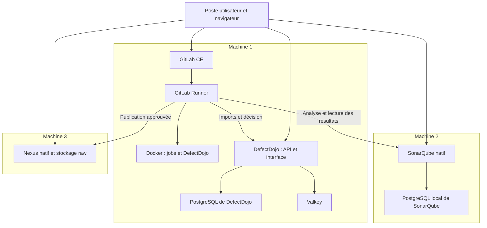

# Architecture et flux

[Accueil](../README.md) · [Installation](INSTALLATION.md) · [Pipelines CI](CI.md)

## Répartition des services

Le schéma décrit la topologie proposée ; Docker et DefectDojo peuvent être
déplacés sur une machine dédiée. Le Runner exécute les jobs et les outils de
scan ; les services reçoivent les analyses, rapports ou artefacts.

## Responsabilités

| Élément | Responsabilité |
| --- | --- |
| GitLab CE | Sources applicatives, orchestration CI, variables protégées et artefacts de jobs |
| Runner / Docker | Tests, résolution des dépendances, construction et scans |
| SonarQube | Analyse de code, couverture et Quality Gate |
| DefectDojo | Regroupement des rapports et suivi des résultats par engagement |
| Helper `gate` | Validation des preuves et application de la politique de publication |
| Nexus | Conservation des artefacts approuvés dans un dépôt raw |

La barrière est du code exécuté par GitLab CI. DefectDojo n’envoie pas
automatiquement une autorisation de publication : le helper vérifie les imports,
relit les résultats puis produit l’approbation.

## Réseau

| Origine | Destination | Port par défaut | Usage |
| --- | --- | --- | --- |
| Poste client et Runner | GitLab | `80` | Interface, API et artefacts, HTTP de laboratoire |
| Poste d’administration / Git SSH | Machine GitLab | `22` | SSH système et Git selon configuration |
| Poste client et jobs | DefectDojo | `8088` | Interface et API |
| Poste client | DefectDojo | `8443` | Publication TLS Compose, certificats à configurer |
| Poste client et jobs | SonarQube | `9000` | Interface, analyse et API |
| SonarQube | PostgreSQL local | `5432` | Base SonarQube sur la machine 2 |
| Conteneurs Dojo | `postgres` / `valkey` | Réseau Compose | Services internes de la pile |
| Poste client et jobs | Nexus | `8081` | Interface et dépôt raw |
| Job Docker CLI | Service Docker-in-Docker du job | `2376` | TLS interne au job |

Le PostgreSQL de DefectDojo et celui de SonarQube sont indépendants. Les noms
de comptes, secrets et sauvegardes ne sont pas interchangeables. Le port 8088
de Dojo évite le port interne 8080 utilisé par GitLab sur la même machine.

Les machines ont aussi besoin des sorties vers les dépôts Ubuntu/éditeurs,
registres d’images, gestionnaires de paquets et sources de vulnérabilités.
Les installateurs n’effectuent pas la configuration DNS, des pare-feu ou d’un
reverse proxy TLS de production.

## Flux d’une livraison

1. Un commit sur la branche par défaut protégée déclenche le workflow.
2. Les jobs testent le code et construisent les livrables. Les images reprennent
   les artefacts testés ; leur hook de démarrage vérifie le contrat du projet.
3. Les scanners et Sonar produisent les rapports. Les images sont scannées depuis
   leur archive Docker brute ; les inventaires applicatif et image sont distincts.
4. Le helper vérifie les rapports, les inventaires et la révision Sonar, puis
   importe les rapports dans un engagement Dojo propre à l’exécution.
5. La politique refuse ou crée `approval.json`, lié au commit, au pipeline et
   aux empreintes des fichiers.
6. Le publisher vérifie les fichiers, envoie les artefacts, les relit et envoie
   l’approbation en dernier. Aucun build n’est exécuté après cette décision.

## Frontières de confiance

- Le fichier d’administration configure les services. Les jobs utilisent des
  identités CI dédiées au périmètre de l’application.
- Un Runner privilégié exécute uniquement du code de confiance sur des références
  protégées ; l’hôte Docker n’est pas exposé par un montage de son socket.
- Les hooks de smoke test sont du code de projet de confiance. Leur nettoyage
  doit être limité aux ressources temporaires qu’ils créent.
- Les clients API du helper refusent les redirections et les pages d’une autre
  origine, pour ne pas transmettre les jetons hors du service configuré.
- `approval.json` est une preuve de décision avec empreintes, pas une signature
  indépendante. La confiance repose aussi sur GitLab, le Runner et les droits
  d’accès aux artefacts.

L’environnement HTTP et les protections fournies sont une base de laboratoire.
Les besoins de production se traitent avec TLS, gestion des accès, supervision,
sauvegarde/restauration et qualification de charge propres au déploiement.
